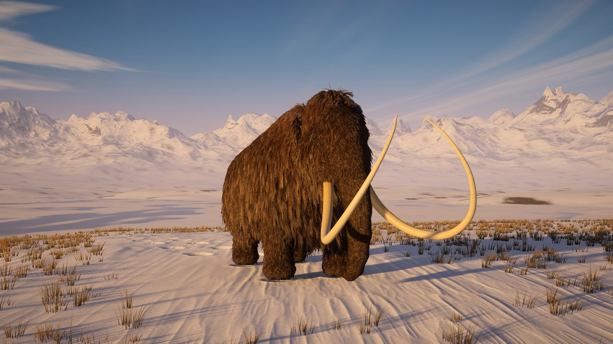
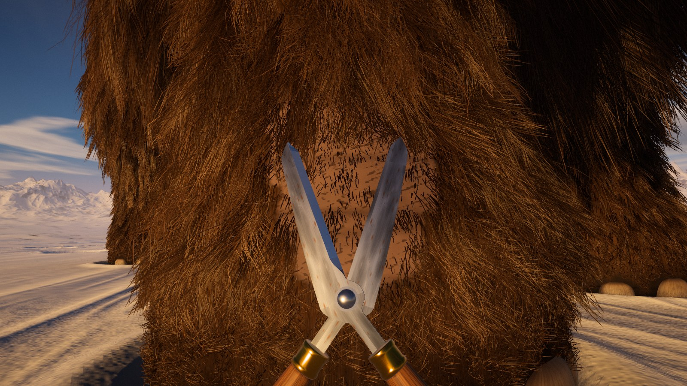

# Shave the Mammoth

A first-person game in the making: you are a very small creature (an elf, perhaps)
and your job is to give one very large woolly mammoth a clean shave.

So far there is the mammoth, its coat, the light and the land around it, and the
first shaving tool: a pair of garden shears, used in first person from the elf's
height. You can also orbit the mammoth, jump between a few views and move the sun.



| Shears in hand | A foreleg part-shorn |
| --- | --- |
|  |  |

The hair that was cut, where it fell:


| Into the sun | From elf height |
| --- | --- |
|  |  |

The coat from shaving distance, about ten centimetres from a foreleg:


It runs in the browser on three.js (WebGL 2). Everything is generated in code at
load time: there are no model, texture or sound files.

## Run it

```bash
npm install
npm run dev
```

Then open the address Vite prints (http://localhost:5173 by default).

`npm run build` writes a static site to `dist/` that can be served from anywhere.

## Controls

| Input | What it does |
| --- | --- |
| **Start shaving** button, or `E` | Pick up the shears at the elf's height (`Esc` or `E` puts them down) |
| Left mouse, or `Space` | Snip. Hold to keep cutting |
| `W A S D`, `Shift`, mouse | Walk, run, look |
| `M` | Sound on or off |
| Drag / scroll | Orbit and zoom (when not shaving) |
| `1` `2` `3` `4` | The mammoth, in profile, into the sun, the coat |
| `H` | Hide or show the controls |
| `P` | Frame rate, resolution, hairs on screen and which graphics card is in use |
| Sun slider | Height of the sun, from last light to mid-morning |
| Detail menu | Low, Medium, High, Ultra |

### Shaving

Walk up to the mammoth. Held away from it, the shears point ahead with the blades
level, and a snip trims whatever hair hangs between them. Press them into the coat
and they turn to lie flat on the hide, pointing up the limb, as a shearer holds
them: a snip there takes everything between the blades and the skin down to
stubble.

The blades part the hair they lie in: hair that would pass through a blade is
pushed off it, either out past its back or into the gap, where it is cut with the
rest. Steel does not pass through the hide, the toenails or the snow either; the
hands give way instead.

The hair that falls is the hair that was cut. Each lock's cut-off part goes on
being drawn from the same strand, by the same shader, and starts exactly where it
was. Then it comes away as one piece: squeezed out of the coat, it drops, turns,
and settles on the snow, where it stays. The readout at the top right shows how
much of the coat has gone.

The elf stands about 20 cm tall at the eye and the shears are 27 cm long, so for
now only the feet, the lower legs and the tip of the trunk are within reach.

The scene also tunes itself while it runs: if the frame rate drops it lowers the
resolution and draws less of the coat, and raises them again when there is headroom.

On a laptop with two graphics cards, check with `P` that the browser is using the
fast one. If it is not, set the browser to "High performance" under Windows
Settings > System > Display > Graphics.

## How it is built

| Part | Where | Notes |
| --- | --- | --- |
| Body | `src/mammoth/anatomy.js`, `sdf.js`, `mesher.js` | The body is a smooth blend of ellipsoids and round cones, turned into a mesh at load. The same description gives the skin weights for the skeleton and the grooming map (hair length, lift, colour) |
| Coat | `src/mammoth/groom.js`, `furMaterial.js`, `mammoth.js` | The groom stores about 240,000 guide strands at High, one per lock of hair. Each is grown in the vertex shader: it leaves the skin, bends under gravity and wind, gathers into locks, and drapes over the body using a baked distance volume. From far away one strand per lock is all the eye can resolve. As the camera approaches, each guide is drawn again and again, and every extra copy becomes a separate hair with its own root, length, curve and colour, some of them short crimped underwool. The coat is split into patches of hide about 40 cm across, so only the patches near the camera pay for this: at shaving distance roughly 600,000 individual hairs are on screen |
| Hair lighting | `furMaterial.js` | Two highlights (surface and through-the-fibre), light passing through the coat when the sun is behind it, and sunlight that soaks into the coat rather than stopping at its surface |
| Sky | `src/world/sky.js` | Rayleigh, Mie and ozone scattering baked to a lookup for the current sun; clouds and the sun's disc drawn live. The sky also supplies the ambient light, reflections and haze colour |
| Land | `src/world/terrain.js`, `grass.js`, `rocks.js`, `particles.js` | Wind-carved snow, a footprint trail, frozen grass, scattered stones, a frozen lake towards the sun, mountains, drifting ice crystals and the mammoth's breath. The mammoth stands sunk a few centimetres into the snow, which fits round each foot |
| Light and shadow | `src/gfx/` | Shadows store depth so materials can measure how much lies between them and the sun: crisp on snow, soft inside fur and grass. Three maps: the land, the mammoth, and a fine one that follows the elf |
| Shears | `src/game/shears.js` | Two identical forgings, one turned over on the other: bevelled blades, cranked tangs, brass ferrules, turned handles, a bolt and nut. Held in front of the eyes with sway and bob, or laid along the hide when pressed into the coat. Some fifty small spheres along every part of both halves are kept out of the mammoth and the snow each frame |
| What is solid | `src/mammoth/collider.js` | The body's own description (ellipsoids and round cones) evaluated exactly, each piece carried by its bone so the swaying trunk is where it looks, with the toenails added. The baked distance volume the fur drapes over is too coarse to hold a blade a few millimetres off the skin |
| Cutting | `src/mammoth/strand.js`, `mammoth.js`, `src/game/shaving.js` | The fur is shaped on the GPU, so the same recipe is followed in JavaScript for the guide strand of each lock to find the ones between the blades. Each is cut as a blade reaches it during the stroke, by writing a shorter length for it; its hairs follow. The hide shows as skin where the coat is down to stubble |
| Hair and steel | `src/mammoth/furMaterial.js`, `shears.js` | The fur's vertex shader is told where the blades are and moves hair off them. As a last guarantee the tool is drawn as if 5.5 cm nearer the eye than it is, so any hair lying that close in front of it is hidden behind it and no strand can be seen passing through steel |
| Cut hair | `src/game/clippings.js`, `furMaterial.js` | A cut copies the strand (and the pose of the skin and the wind at that moment) into a pool drawn by a variant of the fur shader, which grows the same hairs and keeps only the part beyond the cut. That part is then moved as one rigid piece: it falls, turns, flutters, slides off the mammoth and is laid flat on the snow |
| Sound | `src/game/audio.js` | Synthesised with the Web Audio API: blades sliding and meeting, hair parting, boots in snow, wind that follows the gusts on screen |
| Picture | `src/gfx/post.js` | HDR rendering, bloom, light shafts, a film-style tone curve that keeps colour in the highlights, vignette and grain |

## Developer notes

- `tools/shot.mjs` renders a still in headless Chromium for visual checks, e.g.
  `node tools/shot.mjs shots/a.png "shot&q=high&view=2" 1600 900` (needs `npm run dev` running).
  Useful query options: `q` (detail), `view`, `cam=x,y,z,tx,ty,tz`, `fov`, `el` (sun height),
  `az` (sun bearing), `t` (time offset), `stats`, `elf=x,z,yaw,pitch` (start with the shears
  in hand), `snips=n` with `snipyaw` (take n strokes, turning between them), `look=yaw,pitch`,
  `open` (blade angle, 0 to 1), `warm=n` (advance n frames first), `cutdisc=x,y,z,nx,ny,nz,r`
  (shear everything crossing a disc), `shearsat=x,y,z` (lay the shears down to look at them),
  `debugShadow`, `adapt=n` (start n notches down the automatic quality scale), and `debug`
  (exposes the game as `window.__game`).
- `tools/smoke.mjs` drives the live page through every control and reports script errors;
  `tools/snip-test.mjs` picks up the shears and cuts with real key presses;
  `tools/collide-test.mjs` puts the elf in 3,000 places and measures whether any part of
  the shears ends up inside the mammoth or the snow.
- `dev/body.html` shows the bare body from four sides, for working on the anatomy.
- `npm run build:artifact` writes a single page (`dist-artifact/shave-the-mammoth.html`)
  that loads three.js from a CDN.

## What comes next

1. Reaching the rest of the mammoth: climbing its coat, or something to stand on.
2. The mammoth noticing: shifting its weight, lifting a foot, turning its head.
3. More tools, and the elf's hands on the handles (they are below the frame for now).
